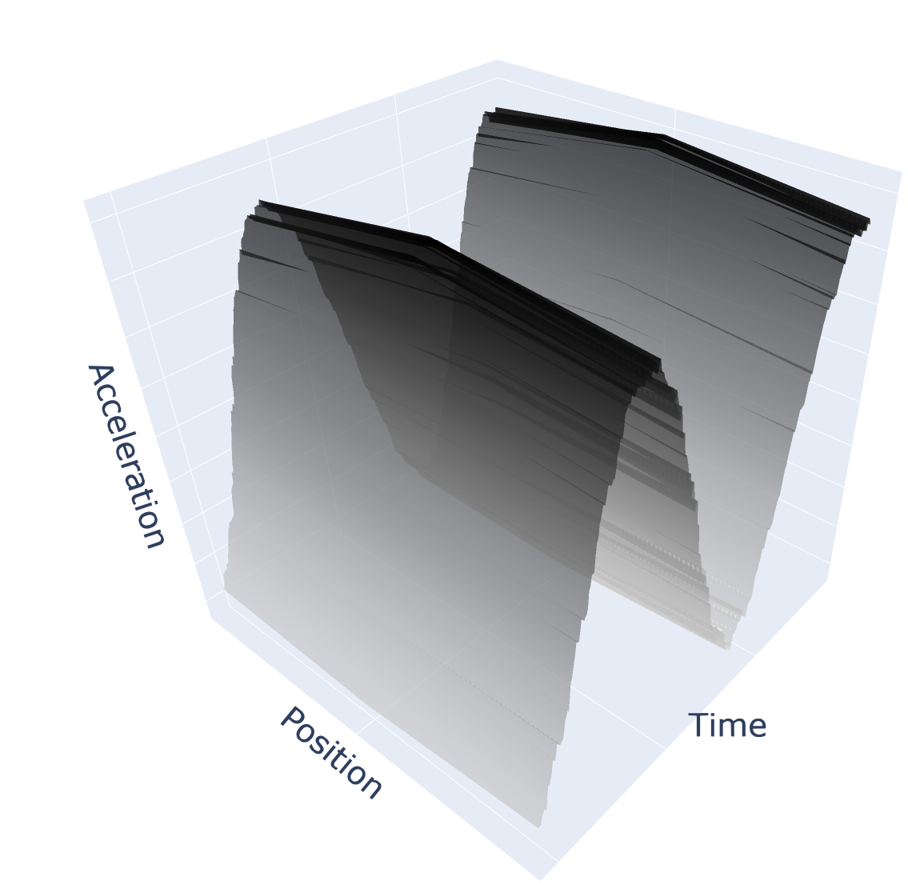

# GARTEUR-Dataset

 # NEEDS CHANGING

## Overview
This repository contains the GARTEUR dataset that creates the GARTEUR Surface from the paper
> **Daisy Bradley, Nathan Hinchliffe, Daniel Pitchforth, Matthew Jones and Elizabeth Cross** (2026). *From Grey-Box to Green-Box: When can Physics-Informed Machine Learning Reduce Carbon Footprints in Structural Health Monitoring?* [[arXiV link](https://arxiv.org/pdf/2609.33387)]

## Data Origin 
The data to generate the surface was collected by Nathan Hinchliffe and James Turner in the University of Sheffield dynamics laboratory.
The GARTEUR SM-AG19 benchmark structure was vibrated close to its first natural frequency (near 10 Hz), with a series of accelerometers placed along its starboard wing.

## The GARTEUR Surface

See the surface below:

The surface shows the acceleration changing over time for three of the accelerometer sensors.

## The Dataset

* **File:** `GARTEUR_data.csv`
* **Format:** Comma-Separated Values (`.csv`)

